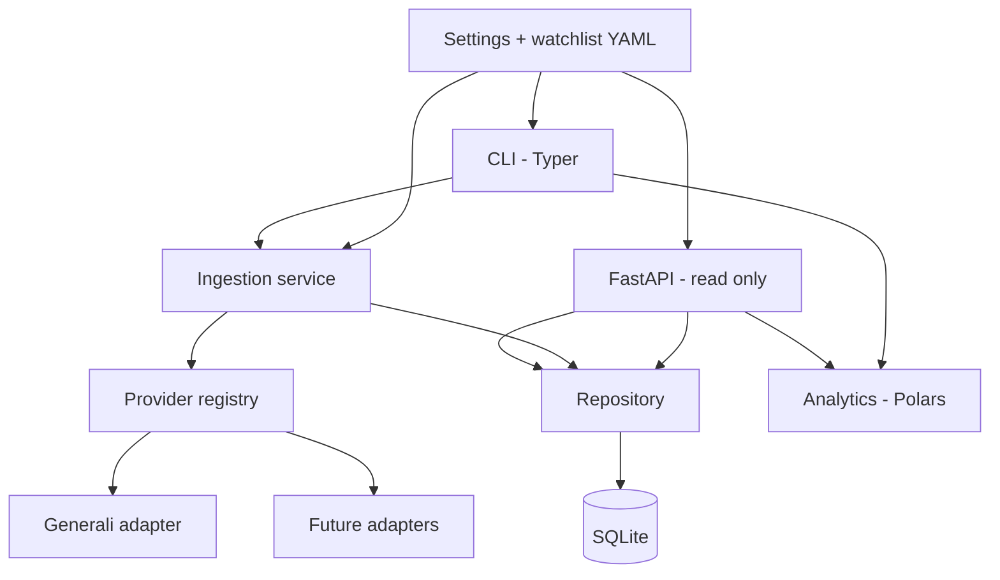
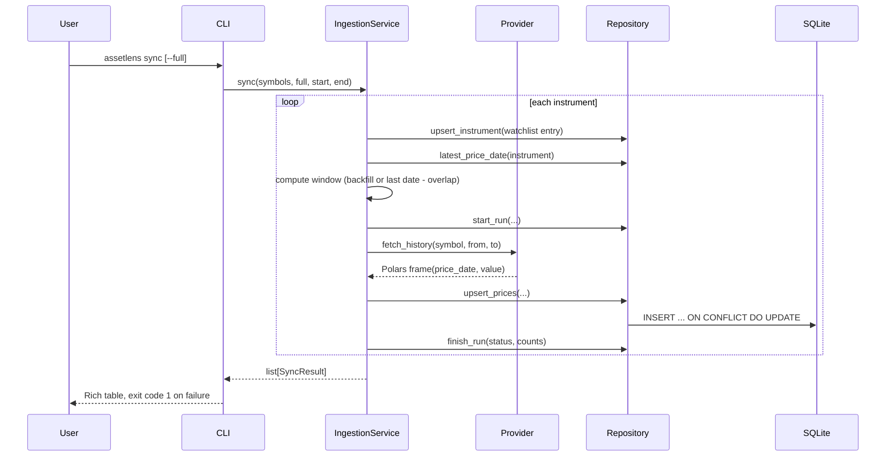

# Architecture

## Goals

`assetlens` answers two questions:

1. *What is the historical series of the instruments I care about?*
2. *How is each instrument performing right now?*

The model is not limited to prices: an instrument declares whether its
observations are prices or annual return rates.

The first release focuses on reliable ingestion and storage. Visualisation and
portfolio accounting are deliberately out of scope, but the design leaves room
for both.

## Non-goals (for the MVP)

- Real-time quotes or intraday data.
- Trading, order execution or brokerage integration.
- Multi-user authentication.
- Redistribution of provider data.

## Layered design

| Layer | Responsibility | Key modules |
| --- | --- | --- |
| Configuration | Environment settings and the instrument watchlist | `config.py` |
| Providers | Turn a source-specific symbol into a normalized frame | `providers/` |
| Persistence | Schema, idempotent upserts, read queries | `db/` |
| Services | Orchestration, retries at the batch level, analytics | `services/` |
| Interfaces | CLI and HTTP API | `cli.py`, `api/` |

Dependencies point inwards: providers do not know about the database, the
repository does not know about HTTP, and the API only reads through the
repository and the analytics module.

## Ingestion flow

### Window selection

- **First sync** (or `--full`): from the instrument `backfill_start` when set,
  otherwise from `ASSETLENS_BACKFILL_START` (2000-01-01), to today in
  Europe/Rome.
- **Incremental sync**: from `latest_date - overlap` to today. The overlap is
  five days for daily series and grows with the frequency (40 days for monthly,
  100 for quarterly, 370 for yearly), so a late monthly publication is not
  missed.
- Explicit `--start`/`--end` always win.

### Idempotency

`prices` has a composite primary key `(instrument_id, price_date)`. Inserts use
SQLite's `ON CONFLICT DO UPDATE`, so running a sync twice is safe and reports
`inserted=0, updated=N` the second time. The repository computes inserted vs
refreshed counts before the upsert. The numeric column is called `value` because
it holds either a price or a return rate.

### Failure isolation

A provider error is caught per instrument, recorded in `ingestion_runs` with
`status='failed'` and the exception message, and the batch continues. The CLI
exits with code 1 if at least one instrument failed, which makes the command
usable from cron or CI.

## Key decisions

### JSON API instead of browser automation

The Generali page renders its chart from `POST /api/quotazioniApi/GetQuotazioniFondo`.
Using that endpoint avoids Playwright/Selenium, is faster, and produces exact
numbers instead of values scraped from a canvas.

### Provider abstraction

Every adapter implements `fetch_history(symbol, start, end) -> pl.DataFrame`
with the schema `{price_date: Date, value: Float64}`. Provider-specific details
(.NET dates, pagination, ISIN mapping) stay inside the adapter. A registry maps
the `provider` key from the watchlist to the class. Providers are value-agnostic:
they reject non-finite values, while the repository enforces the semantics
declared by the instrument.

Adding ETFs or stocks later means adding an adapter (for example Yahoo Finance
or Stooq) and watchlist entries; no changes to storage, CLI or API.

### Price series vs return series

`instruments.value_type` declares how to read `prices.value`:

- `price`: a NAV or market price. Analytics use returns, CAGR, volatility and
  drawdown, exactly as for a fund.
- `return_pct`: an annual percentage return. GESAV is the first example: the
  source publishes the year's return rate every month, with the last
  observation of each year being that year's return. Analytics compound the
  last observation of each calendar year, report the arithmetic average, the
  geometric mean (CAGR) and the best/worst year, and keep the current year as a
  running estimate.

The API and CLI branch on `value_type`, so a return series never goes through
price-based calculations such as `total_return = last / first - 1`.

### Polars, not pandas

Polars is used for normalization, deduplication, returns, volatility and
drawdowns. The repository returns Polars frames directly, so no conversion
layer exists between storage and analytics.

### SQLite with WAL

SQLite is ideal for a single-user local project: zero administration and easy
inspection. WAL mode allows the API to read while the CLI writes. Foreign keys
and a 10-second busy timeout are enabled on every connection.

The repository uses SQLAlchemy 2.0, so migrating to PostgreSQL later is mostly a
URL change plus a new Alembic migration.

### Timezone and date policy

- A price belongs to the **calendar date in Europe/Rome**.
- Provider timestamps are converted to that date in the adapter.
- Audit timestamps are stored as UTC and returned timezone-aware (custom
  `UTCDateTime` type decorator), so API payloads always carry an offset.
- Dates are stored as ISO `YYYY-MM-DD`, which keeps the SQLite file readable.

### Read-only API

Ingestion is a privileged operation: it writes to the database and calls third
parties. Keeping it in the CLI avoids exposing unauthenticated write endpoints.
When a hosted deployment is needed, add authentication and a job queue rather
than opening the current sync endpoint.

## Concurrency and scheduling

- One writer at a time is sufficient. SQLite serialises writes; WAL keeps reads
  available.
- For scheduled updates, run `assetlens sync` from cron or a systemd timer. The
  incremental window makes a daily run cheap (five requests for five funds).
- Do not run two full backfills concurrently against the same database.

## Observability

- Structured, human-readable logs through Rich.
- `ingestion_runs` stores the requested window, row counts, status and error for
  every attempt.
- `GET /health` reports instrument and price counts and fails with 503 when the
  database is unavailable.

## Extension points

| Need | Change |
| --- | --- |
| New fund on Generali | Add a watchlist entry |
| New separate account | Add a watchlist entry with `value_type: return_pct` |
| New data source | Implement `BaseProvider`, register it, add watchlist entries |
| Portfolio tracking | New tables (`transactions`, `positions`) and a service |
| Dashboard | Consume the existing API or query the repository |
| PostgreSQL | Change `ASSETLENS_DATABASE_URL`, add a migration |
| Scheduled sync | cron/systemd invoking the CLI |
