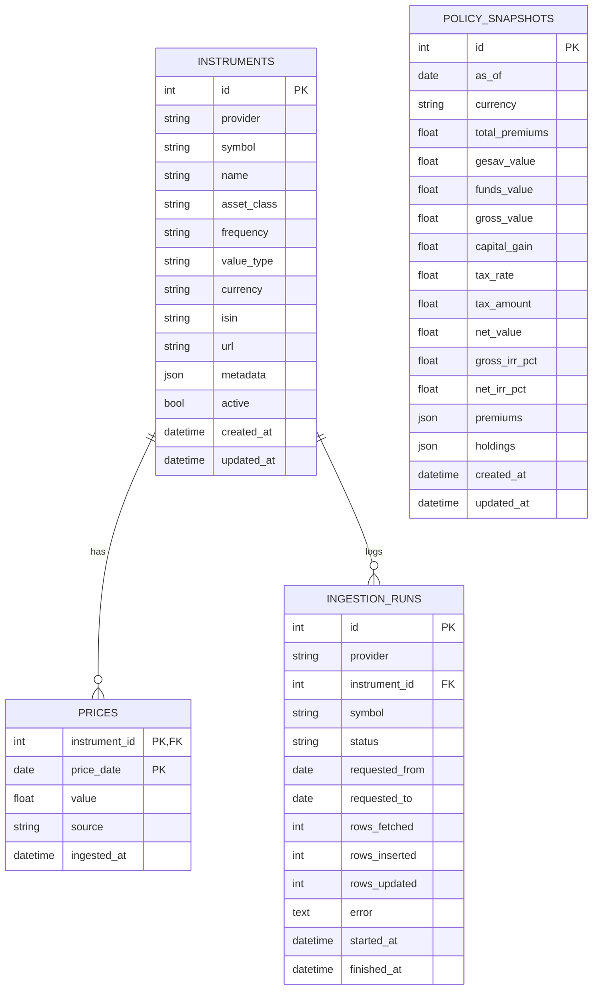

# Data model

## Entity-relationship diagram



## Tables

### `instruments`

One row per tracked instrument. The natural key is `(provider, symbol)`, which
allows the same ticker to exist on multiple providers.

| Column | Type | Notes |
| --- | --- | --- |
| `id` | INTEGER | Surrogate primary key. |
| `provider` | TEXT(50) | Registry key, e.g. `generali`. |
| `symbol` | TEXT(100) | Provider-specific code, e.g. `GI_GEN_TUTELA_CLIMA`. |
| `name` | TEXT(255) | Human-readable name. |
| `asset_class` | TEXT(20) | `fund`, `etf`, `stock`, `crypto`, `separate_account`, `other`. |
| `frequency` | TEXT(10) | `daily`, `weekly`, `monthly`, `quarterly`, `yearly`. |
| `value_type` | TEXT(20) | `price` or `return_pct`. |
| `currency` | TEXT(3) | ISO 4217 code, default `EUR`. |
| `isin` | TEXT(12) | Optional, validated as 12 characters when present. |
| `url` | TEXT(500) | Reference page. |
| `metadata` | JSON | Free-form attributes (umbrella, compartment, ...). |
| `active` | BOOLEAN | Inactive instruments are skipped by sync. |
| `created_at`, `updated_at` | DATETIME | UTC. |

Constraint: `UNIQUE(provider, symbol)`.

### `prices`

The fact table. Composite primary key `(instrument_id, price_date)` guarantees
one observation per instrument per day and makes upserts idempotent.

| Column | Type | Notes |
| --- | --- | --- |
| `instrument_id` | INTEGER | FK to `instruments.id`, `ON DELETE CASCADE`. |
| `price_date` | DATE | Calendar date in Europe/Rome. |
| `value` | REAL | Price or return rate, full source precision. |
| `source` | TEXT(50) | Provider that produced the row. |
| `ingested_at` | DATETIME | UTC, refreshed on every upsert. |

Index: `ix_prices_price_date` supports cross-instrument time queries.

`value` is generic: `instruments.value_type` decides whether it is a price
(`price`, strictly positive) or an annual percentage return (`return_pct`, may be
zero or negative but above -100%). Floating point is acceptable for analysis.
Values are published with six decimals; binary rounding differences are far
below one cent. If exact decimal arithmetic becomes necessary, migrate to
integer minor units or `NUMERIC`.

### Series semantics

| `value_type` | Meaning | Analytics |
| --- | --- | --- |
| `price` | NAV or market price. | Total return, CAGR, volatility, drawdown, 1M/3M/1Y/YTD. |
| `return_pct` | Annual return rate in percent (for example `3.13`). | Compounded annual return, average, geometric mean, best/worst year. |

GESAV is a `return_pct` instrument. The source publishes the current year's
return every month, so the last observation of each calendar year is that year's
return; the latest observation is the running estimate for the current year.
The values are not euro amounts and must not be interpreted as a NAV.

### `ingestion_runs`

Append-only audit log, one row per instrument per sync attempt.

| Column | Type | Notes |
| --- | --- | --- |
| `id` | INTEGER | Primary key. |
| `provider`, `symbol` | TEXT | Denormalised for history after deletion. |
| `instrument_id` | INTEGER | Nullable FK, `ON DELETE SET NULL`. |
| `status` | TEXT(20) | `running`, `success`, `failed`. |
| `requested_from`, `requested_to` | DATE | Window sent to the provider. |
| `rows_fetched` | INTEGER | Rows returned by the provider. |
| `rows_inserted` | INTEGER | New `(instrument, date)` pairs. |
| `rows_updated` | INTEGER | Existing pairs refreshed. |
| `error` | TEXT | Exception type and message on failure. |
| `started_at`, `finished_at` | DATETIME | UTC. |

Index: `ix_ingestion_runs_started_at`.

### `policy_snapshots`

One self-contained valuation of a life-insurance policy, written by
`assetlens policy compute` from the configured policy YAML file. The committed
`config/policy.yaml` contains example data; real figures belong in the
gitignored `config/policy.local.yaml`. The premium schedule and the holdings are
JSON documents, so the row does not depend on other tables; the figures used for
SQL analysis are regular columns.

| Column | Type | Notes |
| --- | --- | --- |
| `id` | INTEGER | Surrogate primary key. |
| `as_of` | DATE | Valuation date. Unique: one snapshot per anniversary. |
| `currency` | TEXT(3) | ISO 4217 code, default `EUR`. |
| `total_premiums` | REAL | Sum of the premiums paid. |
| `gesav_value` | REAL | Value of the separate account (GESAV). |
| `funds_value` | REAL | Value of the unit-linked compartments. |
| `gross_value` | REAL | `gesav_value + funds_value`, before tax. |
| `capital_gain` | REAL | `gross_value - total_premiums` (may be negative). |
| `tax_rate` | REAL | Substitute tax rate, normally `0.20`. |
| `tax_amount` | REAL | `max(capital_gain, 0) * tax_rate`. |
| `net_value` | REAL | `gross_value - tax_amount`. |
| `gross_irr_pct` | REAL | Money-weighted return (TIR) on the gross value, in percent. |
| `net_irr_pct` | REAL | Money-weighted return (TIR) on the net value, in percent. |
| `premiums` | JSON | `[{"paid_on": "YYYY-MM-DD", "amount": 1000.0}, ...]`. |
| `holdings` | JSON | `[{"name": "...", "quote": 0.0, "nav": 0.0, "value": 0.0}, ...]`. |
| `created_at`, `updated_at` | DATETIME | UTC. |

The TIR is computed with the same dates as the cash flows and a 365.25-day
year, by solving `NPV(rate) = 0` on:

```
TIR: -premium_i / (1 + r)^((date_i - date_0)/365.25) + value / (1 + r)^((as_of - date_0)/365.25) = 0
```

## Date and timezone semantics

- `price_date` is a date, not a timestamp. The Generali API returns UTC
  instants; the adapter converts them to Europe/Rome before extracting the day.
- Audit columns are UTC. SQLite stores them as naive UTC and PostgreSQL as
  `timestamptz`; the `UTCDateTime` decorator re-attaches `UTC` on read, so JSON
  responses include an offset.
- The incremental overlap uses calendar days, not trading days. Holidays are
  harmless: the provider simply returns no row for those dates.

## Useful queries

```sql
-- Coverage per instrument
SELECT i.symbol, COUNT(*) AS rows, MIN(p.price_date) AS first, MAX(p.price_date) AS last
FROM prices p
JOIN instruments i ON i.id = p.instrument_id
GROUP BY i.symbol
ORDER BY i.symbol;

-- Latest price per instrument
SELECT i.symbol, p.price_date, p.value
FROM prices p
JOIN instruments i ON i.id = p.instrument_id
WHERE (p.instrument_id, p.price_date) IN (
    SELECT instrument_id, MAX(price_date) FROM prices GROUP BY instrument_id
)
ORDER BY i.symbol;

-- Annual returns of a return-based instrument
SELECT strftime('%Y', p.price_date) AS year, p.value AS return_pct
FROM prices p
JOIN instruments i ON i.id = p.instrument_id
WHERE i.symbol = 'GESAV'
ORDER BY p.price_date;

-- Recent failures
SELECT started_at, symbol, status, error
FROM ingestion_runs
WHERE status = 'failed'
ORDER BY started_at DESC
LIMIT 20;

-- Policy snapshots: gross, tax, net and TIR
SELECT as_of, total_premiums, gross_value, capital_gain, tax_amount, net_value,
       gross_irr_pct, net_irr_pct
FROM policy_snapshots
ORDER BY as_of;
```

## Schema migrations

Alembic owns the schema. The initial revision is
`migrations/versions/0001_initial.py`.

```bash
uv run assetlens init-db          # upgrade to head
uv run alembic revision --autogenerate -m "add table"
uv run alembic upgrade head
```

Tests use `Base.metadata.create_all` for speed; production and local development
use Alembic so schema changes are reproducible.
